# Using the Agent Factory console

The console is the web front end of the Agent Factory Service. What you see depends on your role: service
admins see every team and the service settings, team admins see their own teams, team viewers can read but
not change. A control you may not use is shown disabled with a tooltip such as "Requires team-admin"; an
admin-only area is not shown to team roles at all. The API makes the final decision on every change.

Every create form shows the equivalent `afs` command, so you can script what you just did.

## Service dashboard (`/`, service admins)

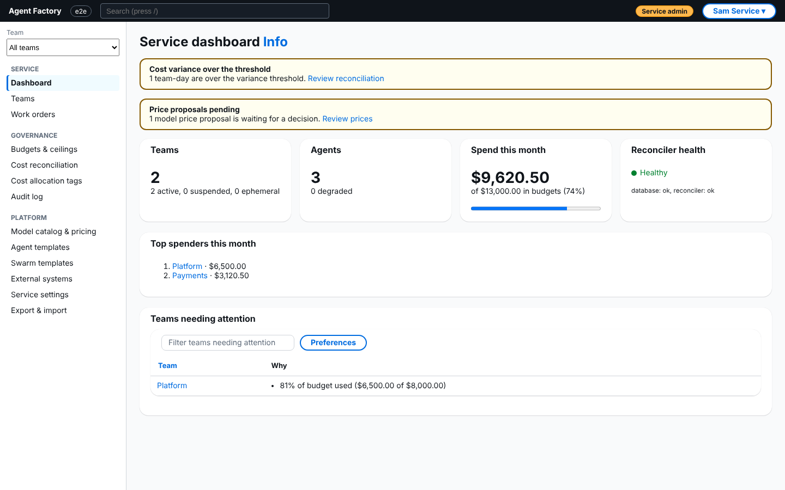

Team and agent counts, this month's spend against the sum of team budgets, reconciler health and the five
biggest spenders, each linking to its team. **Teams needing attention** lists teams that expire within 7
days, use 80% or more of their budget, are *Budget blocked*, have *Degraded* agents or had drift reverted in
the last 24 hours, with the reason for each. A yellow banner appears when team-days are over the cost
variance threshold or model price proposals are waiting. Agent counts cover the first 50 active teams.

## Teams (`/teams`, service admins)

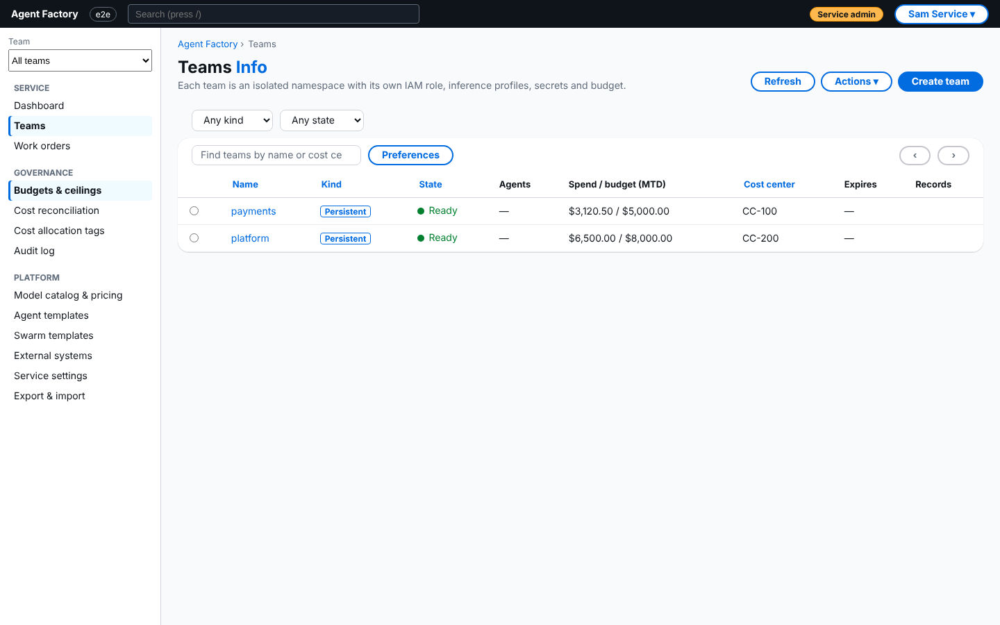

The table shows state, spend against budget, cost center and, for ephemeral teams, the expiry. Select a team
and use **Actions** to suspend, resume, set a ceiling, raise it temporarily or delete (you type the slug).
**Create team** opens a wizard with a review step that prints the `afs teams create-team` command. A new
team shows *Reconciling* and turns *Ready* without a reload.

## Team overview (`/t/<team>`)

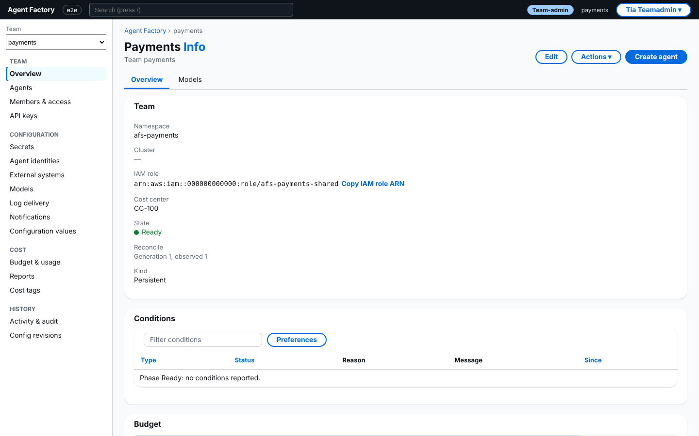

Namespace, IAM role, cost center, conditions, budget burn, agent health, recent activity and work orders;
each card loads on its own, so one failing card does not hide the rest. The **Models** tab
(`?tab=models`) lists the team's enabled models; only service admins edit them. **Edit** changes the display
name, description, owner and sign-in provider; if someone changed the team meanwhile you are asked to reload
and your edits stay in the form. While a team is suspended a banner says so and every change is disabled
except *Resume*. Team viewers get the same page with a read-only notice.

## Members and API keys (`/t/<team>/members`)

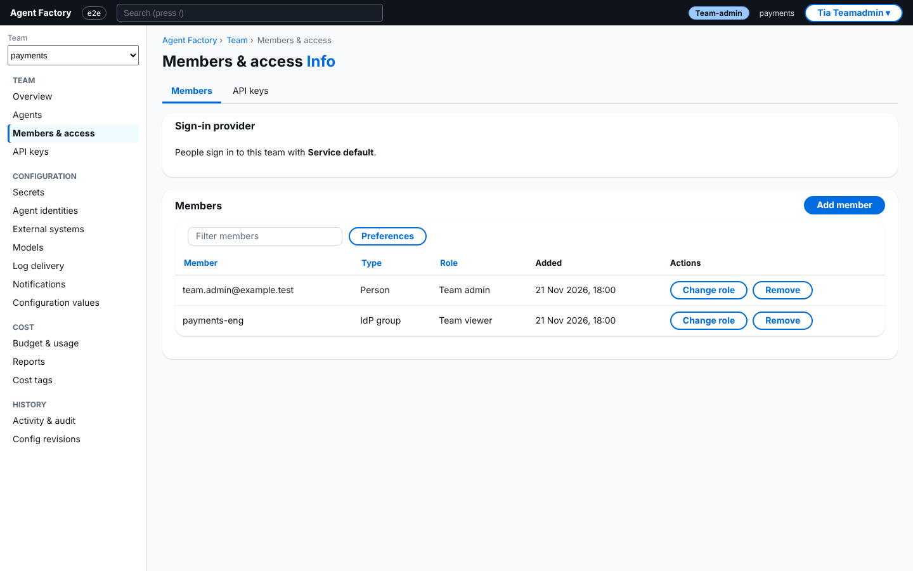

Add a person by email or an IdP group as team admin or team viewer; change a role; remove. The team's
sign-in provider is shown and team admins can change it among the enabled providers. **API keys** (team
admins and service admins only) creates a key with a name, a role and an expiry of up to 90 days (30 by
default). The secret is shown once; copy it before you close the dialog. If a retry returns the key without
its secret, the dialog says so and offers **Delete key** so you can create a new one.

## Team orchestration (`/t/<team>/orchestration`)

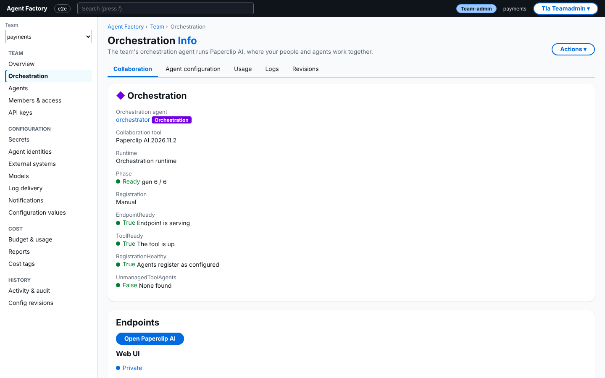

Every team has one orchestration agent, created with the team. It runs the team's collaboration tool, **Paperclip AI**
(the default) or **Buzz**, and the screens call its runtime the *Orchestration runtime*. Purple and the diamond mark
identify orchestration; they are not used for anything else.

On the page team admins see the agent's status and conditions, and the **Web UI** and **Web API** endpoints. Each is
**Off**, **Private** or **Public**, up to the limit a service admin set for the team; a level above the limit stays
visible but disabled, with the reason. Buzz has no web surface, so both show *N/A*. **Actions** has *Edit endpoints*
(review step, with a warning before *Public*, and the equivalent `afs` command), *Change tool* (type the team's name to
confirm; the new tool starts with an empty data directory and the old data stays in a snapshot), *Rotate tool keys*
and the registration mode. You can also connect or disconnect the team's worker agents, see the secrets AFS and the tool
manage (names and state only, never values), and read recent access. The **Agent configuration** tab is the same
screen as any agent's configuration, with models and the persistent volume.

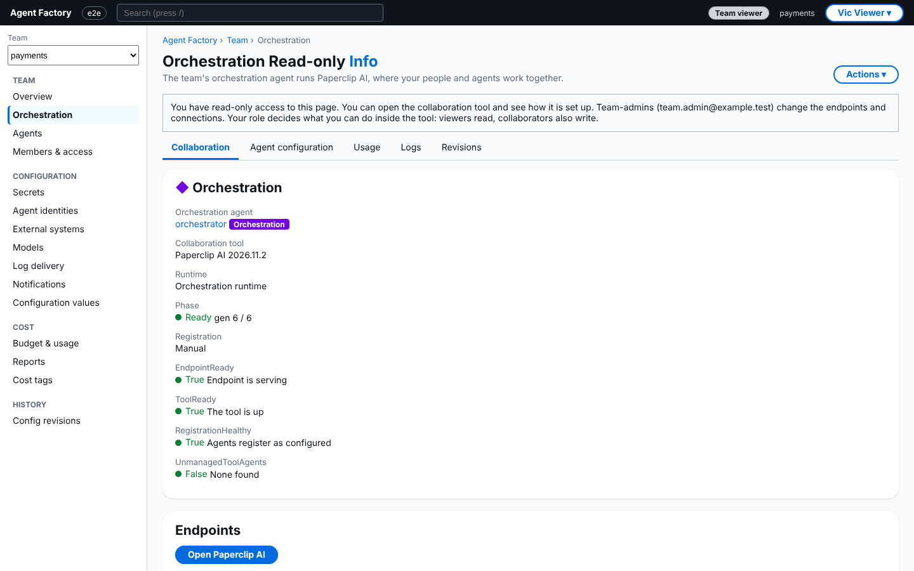

Team viewers and the team collaborator role see a read-only version with the same status and a link to open the tool.

Service admins use **Orchestration** under *Platform* (`/orchestration`):

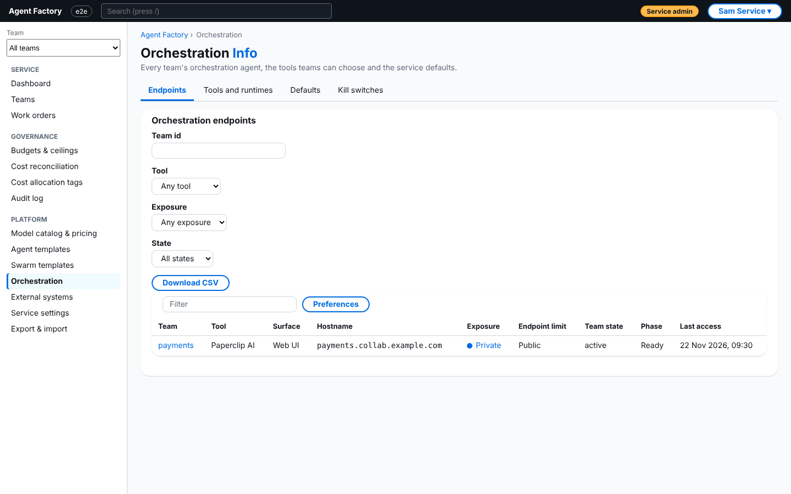

- *Endpoints*: every team's endpoints with tool, level, effective level and hostname, filters, a CSV download and the
  progress of adding orchestration agents to teams that predate 1.1.0.
- *Tools and runtimes*, *Defaults* and *Kill switches*: the `orchestration.*` service settings (tool profiles, base
  domains, the default limit and exposure, the public and private switches).

They also set each team's limit (**Actions, Set endpoint limit** on *Teams*), mark agent templates with the `paperclip`
capability and choose an orchestration template in a swarm template. **Reports, Collaboration** (team and service)
counts sign-ins, people, requests, denied requests and secret detections by day, surface, reason or person; it cannot
be scheduled.

## Models

Model access is set at three levels, each either **All** (follow the level above) or **Selected**, plus a default
model: the service (**Models**), the team (*S3* step 3 and the team's *Models* tab, service admins only) and the agent
(*Create agent*, the agent configuration and the pool form, team admins). Each list offers only what the level above
allows and says how many models that is. Narrowing a list never edits a stored selection below it. Every form shows
the equivalent `afs` command (`teams put-team-models`, `agents update-agent --models`, `admin put-service-model-access`).

## Agents (`/t/<team>/agents`)

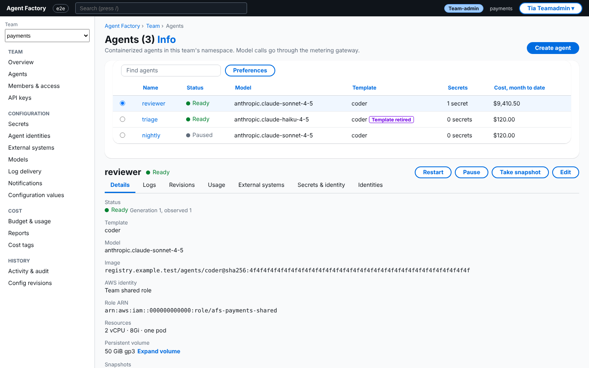

The team's agents with status, model, template, secret count and month-to-date cost; one list request per
polling interval. Select an agent for its panel: **Restart**, **Pause** or **Resume** (with a confirmation),
**Take snapshot**, **Edit** and **Expand volume** (grow-only). Tabs show details, where logs are delivered,
revisions and external systems. A template that was retired shows *Template retired*. Viewers see the same
panel with every action disabled "Requires team-admin".

## Create agent (`/t/<team>/agents/new`)

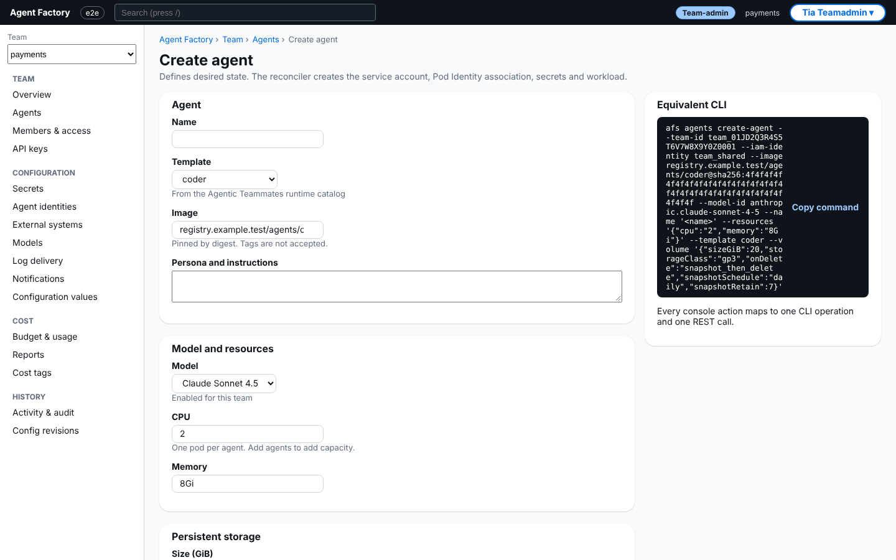

One page with sections for the agent, model and resources, storage, identity, configuration values and secret
bindings, plus a help panel and the equivalent `afs` commands. The persona is sent as the description. Secret
bindings pick existing secrets by name; values are never typed here. A configuration value whose name looks
like a credential is refused: store it under Secrets.

## Secrets (`/t/<team>/secrets`)

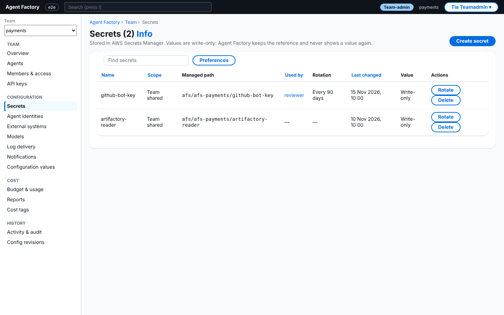

Names, scope, the managed Secrets Manager path, which agents use each secret, rotation and last change.
**Create secret** and **Rotate** take a value in a password field that is sent once and cleared; the console
never shows it again (the column reads *Write-only*). Deleting a secret agents use is refused and links to
those agents. Team viewers get the same table without values or actions.

## Configuration values (`/t/<team>/config`)

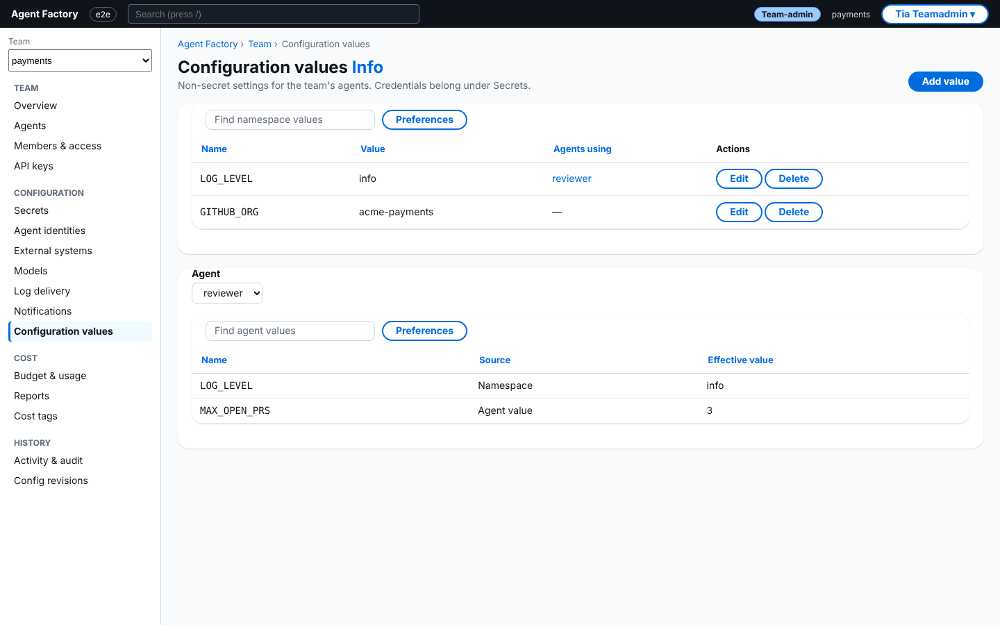

Non-secret namespace values shared by the team's agents, with the agents using each; below, an agent's values
showing whether each is its own or the namespace's and what the agent receives. Saving a value agents use
warns which agents restart; a value agents use cannot be deleted. Names are UPPER_SNAKE_CASE and
credential-like names are refused with a link to Secrets.

## External systems (`/t/<team>/external-systems`, agent tab, `/external-systems`)

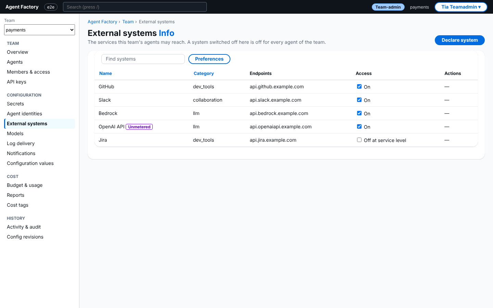

Each team switch shows inherited state: a system off at the service level is shown off and locked, with the
level named. Unmetered systems carry an *Unmetered* badge. **Declare system** is enabled only for teams a
service admin allowed to declare their own. The agent's **External systems** tab switches a system off for
that agent only (*Off at agent level*). Service admins manage the catalog at `/external-systems`: built-in
systems cannot be deleted, a service switch turns a system off for every team, enabling an unmetered system
asks for confirmation, and a list below chooses which teams may declare their own systems.

## Storage classes and agent templates (`/settings/storage-classes`, `/settings/agent-templates`)

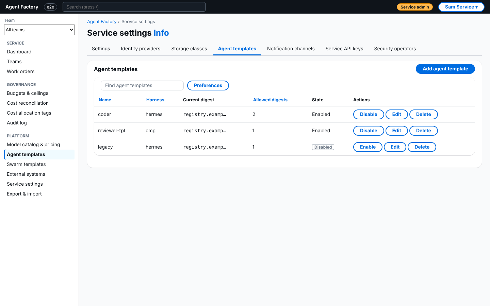

Service admins add, edit, enable or disable and remove storage classes and agent templates (harness, default
resources, allowed digests with one current). A class or template agents still use cannot be removed.

## Service settings (`/settings/general`, service admins)

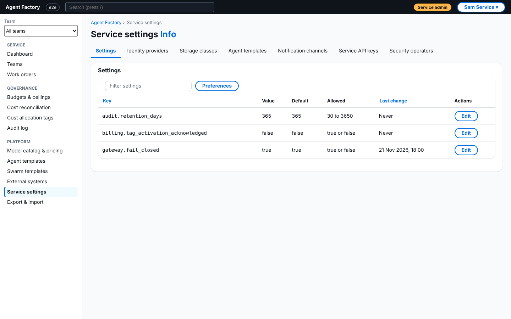

**Settings** lists every key with its value, default, allowed range and last change; **Edit** checks the
range before sending. **Identity providers** adds, edits, disables and sets the default Okta or Entra ID
provider; select a provider to see the teams using it. A provider in use cannot be disabled. A client secret
is never entered in the console: give the ARN of its Secrets Manager secret; only the ARN is shown.

## History (`/t/<team>/history/audit`, `/t/<team>/history/revisions`)

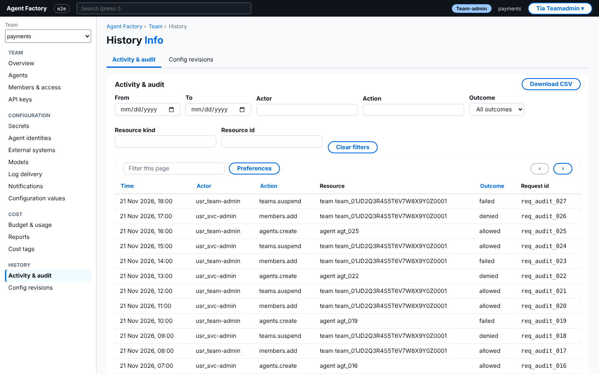

**Activity & audit** lists who did what, with outcome and request id. Filter by period, actor, action,
outcome and resource; the filter is in the URL, so you can share it. **Download CSV** saves everything that
matches. **Config revisions** lists revisions per resource; tick two revisions of the same resource to see
what changed between them.

## Budget and usage (`/t/<team>/budget`)

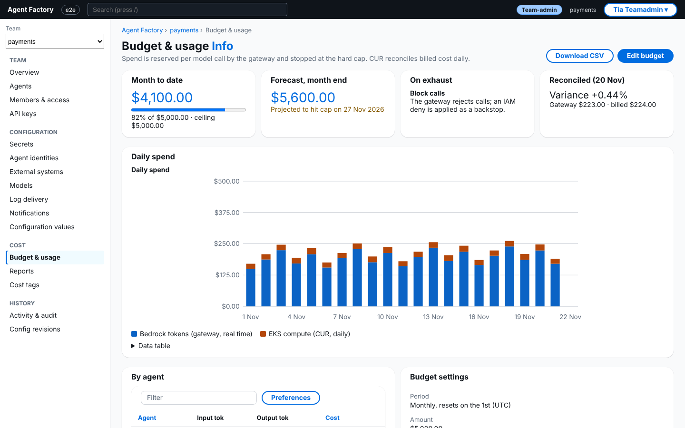

Shows month-to-date spend against the budget, the forecast and the date the cap is projected to be hit, daily spend
split between Bedrock tokens and EKS compute, and spend by agent. *Edit budget* changes the amount, period and
thresholds; only a service admin can choose what happens at exhaustion. *Download CSV* returns the usage report.

## Reports (`/t/<team>/reports`, `/t/<team>/reports/agents/<agent>`, `/reports`)

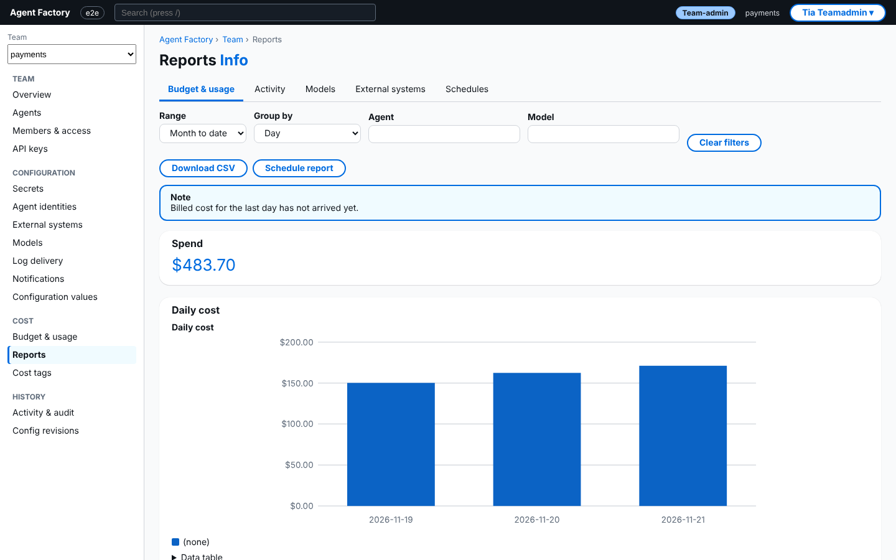

Team reports have tabs for budget and usage, activity, models and external systems. Pick a range, group by and
filters; each report has a chart with a data table alternative, the API's notes, and *Download CSV*. Traffic reports
show counts and bytes, never a cost, and flag unmetered systems. An agent's *Usage* tab links to its report. Service
admins also have `/reports` and *Cost reconciliation*, which lists team-days where the gateway estimate and the billed
cost differ.

## Model endpoints (`/model-endpoints`, service admins)

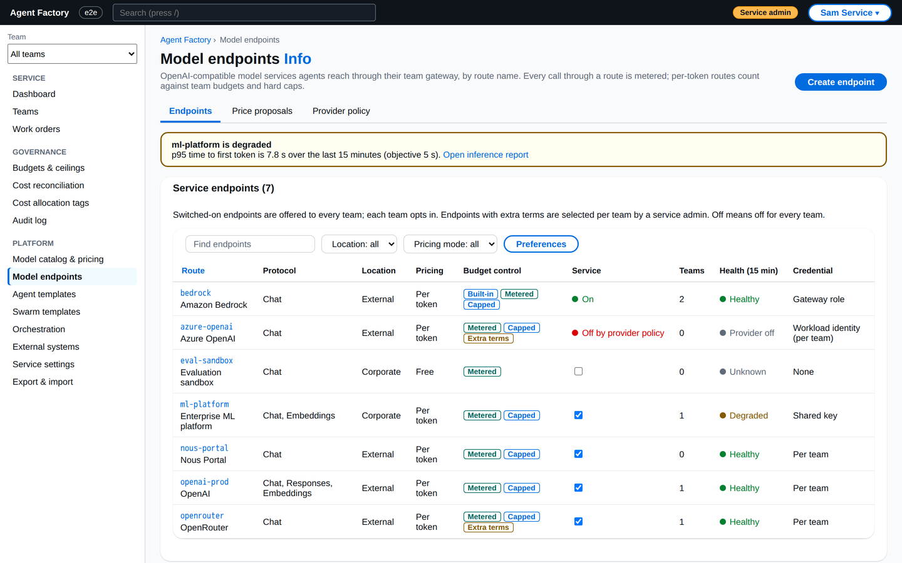

OpenAI-compatible model services that agents reach through their team gateway, by route name. Every call is
metered; per-token routes count against team budgets and hard caps, capacity and free routes are reported only.

- **Endpoints**: the service catalog with its badges (Built-in, Metered, Capped, Extra terms), a switch per endpoint
  (off means off for every team), health over 15 minutes, and the endpoints teams declared. *Create endpoint* is a
  wizard with a review step and the equivalent `afs model-endpoints create-model-endpoint` command; the endpoint is
  created off, and a per-token model without both prices is saved but not callable.
- **Endpoint detail** (`/model-endpoints/<id>`): models and prices (*Add price*), and *Teams & credentials*: set or
  rotate a shared or per-team key, or enter the workload identity federation identifiers. Credential values are
  write-only: they live only in the masked field until sent, and are never shown again.
- **Price proposals**: approve or reject a price read from a provider price list, beside the price it replaces.
- **Provider policy** (`/model-endpoints/providers`): one switch per provider, Bedrock included. Turning one off
  shows the impact first (routes refused, teams and agents affected). Bedrock also needs a fallback route model
  selected for every team before *Turn off* is enabled.
- **A team's gateway** (`/teams/<team>/admin`, *Model endpoints* tab): the gateway deployment, whether the team may
  declare its own endpoints, and the team's routes (endpoints with extra terms are selected here).

## Team model endpoints (`/t/<team>/model-endpoints`)

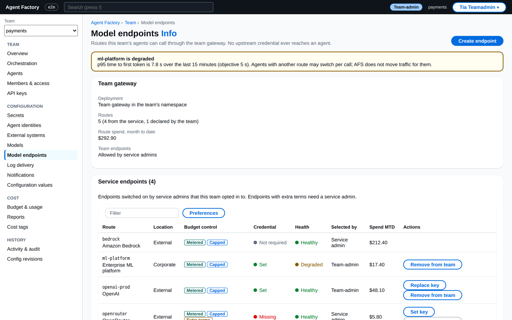

The routes this team's agents can call: the service endpoints the team added (with spend this month), those it may
add, and the team's own endpoints. Team-admins add and remove service endpoints and set the team's key; an endpoint
with extra terms says *Needs a service admin*. *Create endpoint* declares a team endpoint (for example vLLM in the
team's namespace) when a service admin allows it. Team viewers see the same page read-only.

On an agent, the *Models & routes* tab keeps the Bedrock model choice and adds the agent's routes (all team routes
or a selection), the default route and model, and *What the agent receives*: the `AFS_LLM_*` and `OPENAI_*`
variables on its next restart. No upstream credential reaches an agent. Saving restarts the agent's pod; the
equivalent command is `afs agents update-agent --models '<json>'`.

The *Inference* tab of the reports (`/reports/inference`, `/t/<team>/reports/inference`) shows calls, errors,
tokens, cost and latency by route, model, agent or time, with a CSV download. *Budget & usage* adds spend by route,
marking which routes count against the hard cap.

## MCP servers (`/mcp-servers`, service admins and security operators)

MCP servers agents reach through their team gateway. Agents hold no MCP credential: the gateway injects or mints it
per call. Access only narrows: service, then team, then agent.

- **Catalog**: enterprise and team-managed servers with kind, transport, authentication, status, risk and adoption,
  the MCP calls and discovery hit rate, and an alert while items wait for review. *Import server.json* pre-fills a
  draft from an MCP Registry manifest; importing never counts as approval.
- **Add enterprise server** (`/mcp-servers/new`): purpose, connection and authentication, policy and availability,
  then review with the equivalent `afs mcp-servers create-mcp-server` command. The server is created as a draft.
- **Server detail** (`/mcp-servers/<id>`): overview and automatic checks; *Tools, resources & prompts* with held
  changes and their diff; policy rules (block or allow by name or class, rate limits); shared or per-team
  credentials (write-only); the teams that use it; usage. *Actions* publishes, retires, suspends (with a reason),
  resumes or deletes it.
- **MCP reviews** (`/mcp-reviews`, security operators and service admins): team servers waiting for a decision and
  held definitions, oldest first. A review shows the checks, why the risk tier, the inventory with *Allow* or
  *Block* per definition, and a required note; *Approve*, *Reject* or *Ask team for changes*.
- **Report** (`/reports/mcp`): usage, unused, refusals, discovery and adoption, with CSV, and a time-boxed query
  capture for tuning search.
- **Settings** (`/settings/mcp`): who approves team-registered servers.
- A team's gateway settings (`/teams/<team>/admin`, *Model endpoints* tab) say whether the team may register its own
  servers and where they run.

## Team MCP servers (`/t/<team>/mcp-servers`)

The enterprise servers with a switch and a mode (Full or Read-only) each, the credential state with *Connect*,
*Reconnect* or *Set credential*, and the team's own servers with their review state. *Register team server* is a
wizard that registers the server and submits it for review; the automatic checks set the risk tier, which decides
whether a team-admin or a security operator approves it. Team viewers see the page read-only.

On an agent, the *MCP* tab chooses all team servers or a selection, blocks single tools, sets the discovery mode
(*Search*: three `afs_*` tools; *Full*: every allowed tool), shows *What the agent receives* and the effective tools
with the level that decided each. Saving rolls the pod; the gateway enforces changes at once. The *Secrets &
identity* tab adds federated identities: a short-lived token for an audience outside AWS, mounted as a file whose
path is in `AFS_FEDERATED_TOKEN_FILE_<NAME>`. *MCP usage* (`/t/<team>/mcp-usage`) is the team's own report. An
external system governed by an MCP server shows its switch locked with a link to the server.

## Model catalog and pricing (`/models`, service admins)

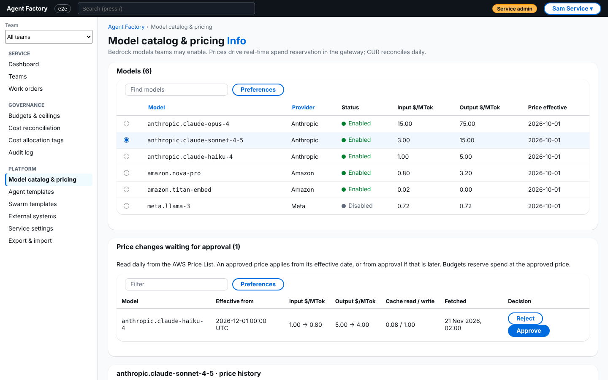

Models with the price in effect now, pending price proposals to approve or reject, and each model's price history.

## Notifications (`/t/<team>/delivery/notifications`)

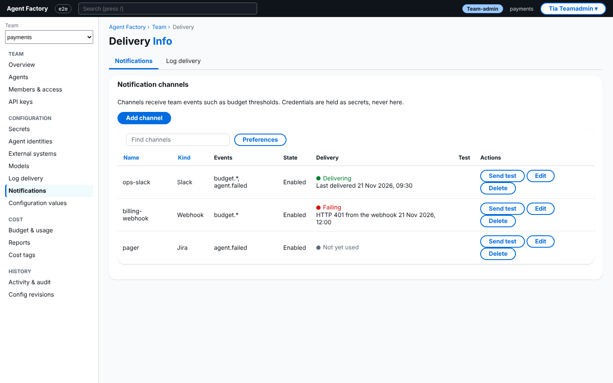

Channels (Slack, email, webhook, Jira, EventBridge) with their events and delivery status. A failed delivery shows its
error on the channel. *Send test* sends one message and shows whether it was delivered; a pending test is followed
until it is reported. Credentials are chosen as secrets and are never shown. Deleting a channel lists the report
schedules that deliver to it first.

## Audit log (`/audit`, service admins)

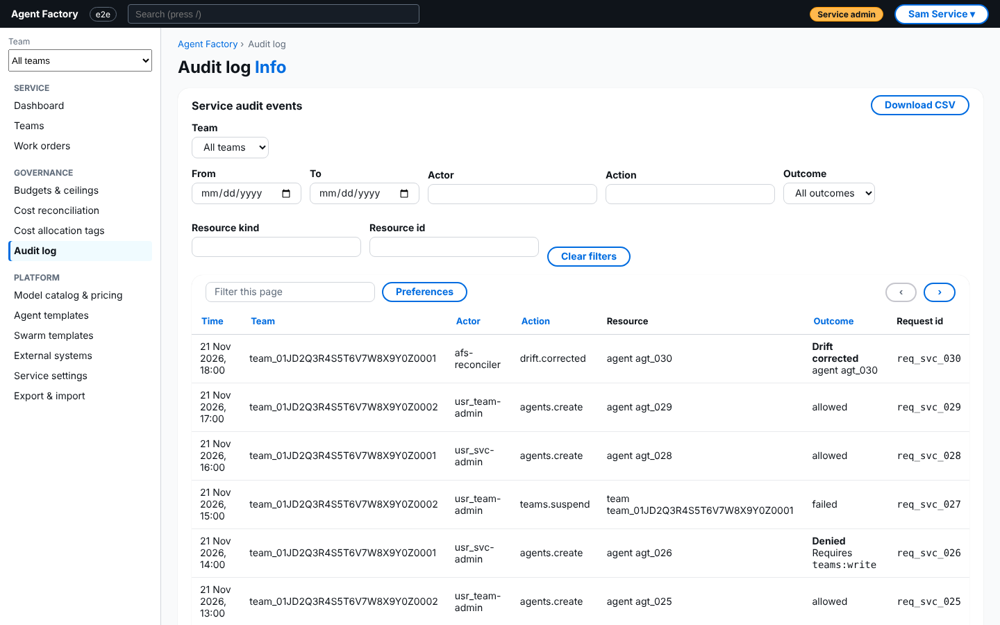

Every audit record across teams. Filter by team, actor, action, outcome (allowed, denied, failed), resource and period;
the filters are in the address, so a filtered view can be shared. A denied request shows *Denied* with the permission it
needed, and a correction the reconciler made shows *Drift corrected* with the object. *Download CSV* returns the same
filters as a file.

## Team AWS accounts (`/teams/<team>/admin`, *AWS accounts* tab, service admins)

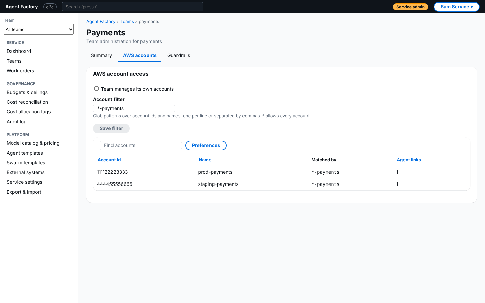

The account filter is a list of glob patterns over account ids and names (`*` matches any run, `?` one character; `*` alone
allows every account). Below it, the organization accounts the filter allows are listed with the pattern that matched and
the number of agent links to each. A change that narrows the filter first lists the accounts it removes and how many agent
links will be disabled, and asks you to confirm. *Team manages its own accounts* is changed by service admins only; when it
is on, the team's admins can edit the filter themselves, otherwise they see it read-only with "Requires service admin".

## Cost allocation tags (`/cost-tags`, service admins)

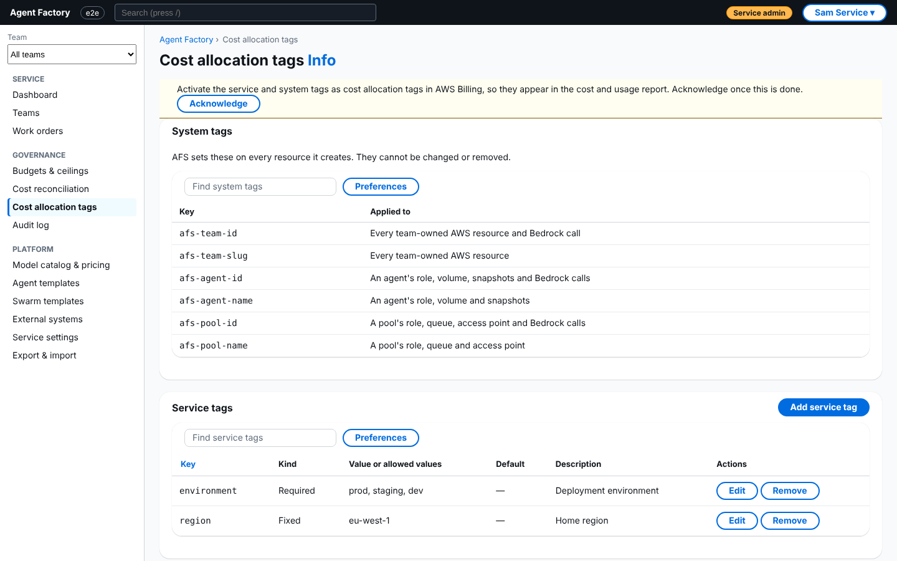

System tags (always set by AFS) are listed read-only. Service tags are either fixed (the same value for every team) or
required (each team sets a value, optionally from an allowed list, with an optional default); add, edit and remove them
here. Teams that still miss a required value are listed with a link to their tags. *Spend by tag* is the cost report
grouped by any tag key, with records lacking a value shown as "(untagged)". Until a service admin acknowledges it, a
notice asks you to activate the tags as cost allocation tags in AWS Billing.

## Team tags (`/t/<team>/tags`)

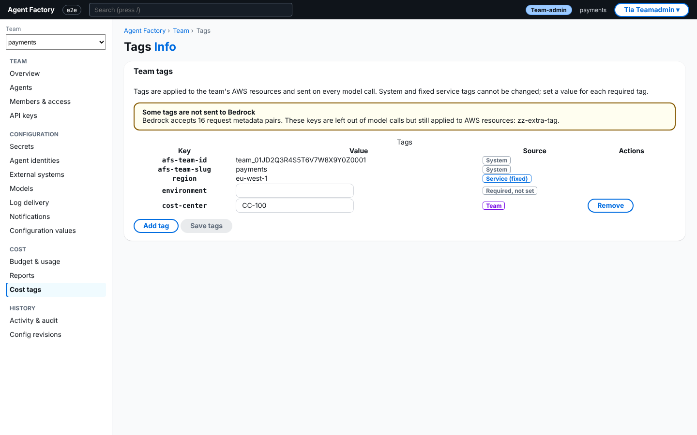

Every tag on the team with its source: system, service (fixed), service default, required but not set, or team.
Team-admins set the required values and add or remove their own tags; system and fixed tags are read-only, and viewers
see everything without edit controls. Keys that do not fit in the 16 request metadata pairs sent to Bedrock are listed.

## Agent AWS access (`/t/<team>/identities`, agent *Secrets & identity* and *Identities* tabs)

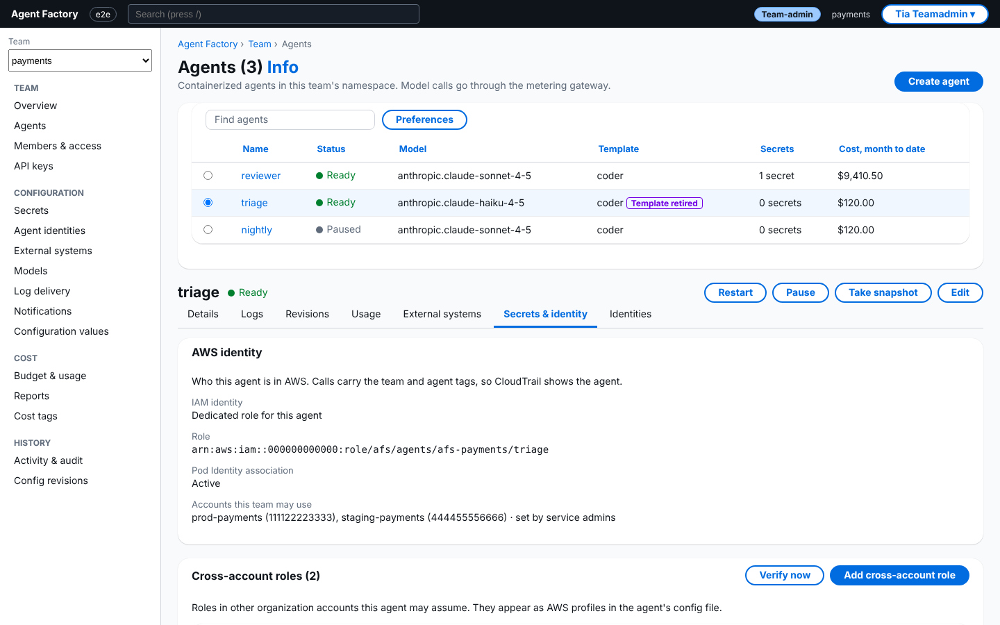

*Secrets & identity* shows whether the agent has a shared or dedicated IAM role, the role, and the accounts the team may
use. For a dedicated agent, *Add cross-account role* offers only accounts inside the team's filter. The new role shows
a trust policy with an external ID and *Copy*; the link stays *Pending trust* until *Verify now* succeeds (*Verified*) or
fails with the reason (*Failed*). *Identities* lists the agent's external identities with add and remove. The team view
lists every agent's identity and links and holds the *AWS account access* section. Viewers read everything; changes are
disabled with the role required.

## Log delivery (`/t/<team>/delivery/logs`)

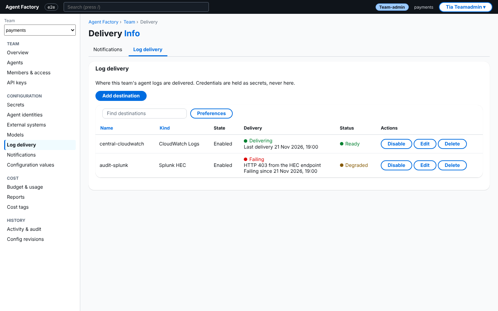

The team's log destinations (CloudWatch, S3, OTLP, Splunk HEC, Datadog) with state, delivery status (and the reason
when failing) and the last delivery time. Team-admins add, edit, enable, disable and delete destinations; the
credential is chosen from the team's secrets, never typed. Viewers see the list with changes disabled.

## Export and import (`/export-import`, service admins)

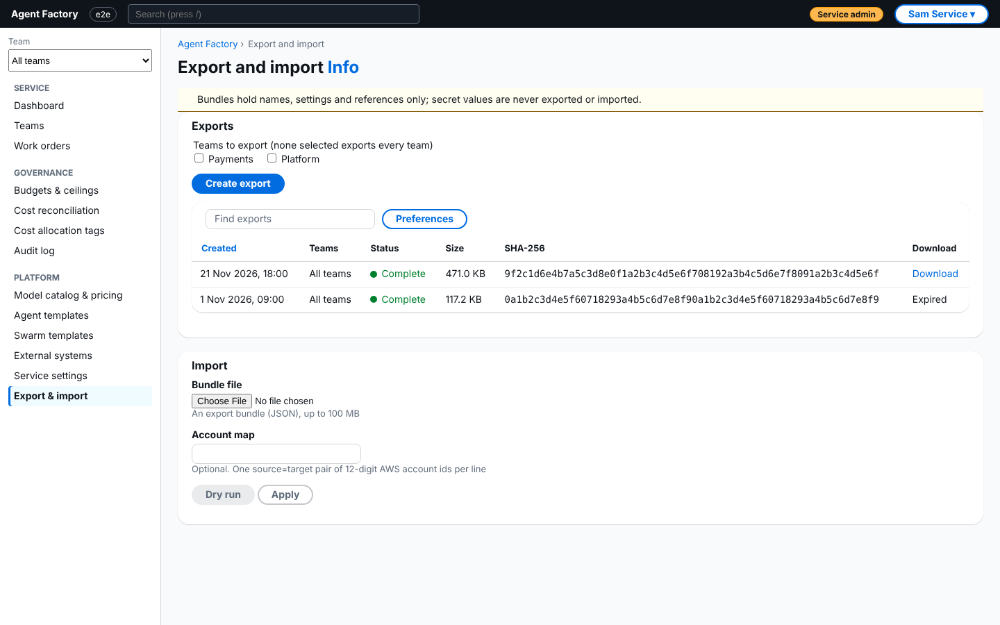

*Create export* bundles every team or the teams you tick; the export is prepared in the background and its row gains a
download link, valid for 7 days and then shown as *Expired*. Bundles hold no secret values. *Import* takes a bundle file
(up to 100 MB) and an optional account map (`<source account id>=<target account id>`, one per line). *Dry run* shows
what would change for each team; *Apply* is enabled only for the same inputs you just dry-ran, and asks to confirm.

## Report schedules and restore

On each team report tab, *Schedule report* (team-admins) sends the report as you have configured it as CSV on a daily,
weekly or monthly cadence to one of the team's notification channels. The *Schedules* tab lists each schedule with its next
run, last run and last status (a failed run shows its error) and lets you pause, resume or delete it.

On the history *Config revisions* tab, select one revision and choose *Restore* (team-admins): the plan lists what would
change and which bindings no longer resolve and are skipped. *Apply restore* asks to confirm; the restore becomes a new
revision. Viewers can view and compare revisions but cannot restore.

## Service notification channels (`/settings/notification-channels`, service admins)

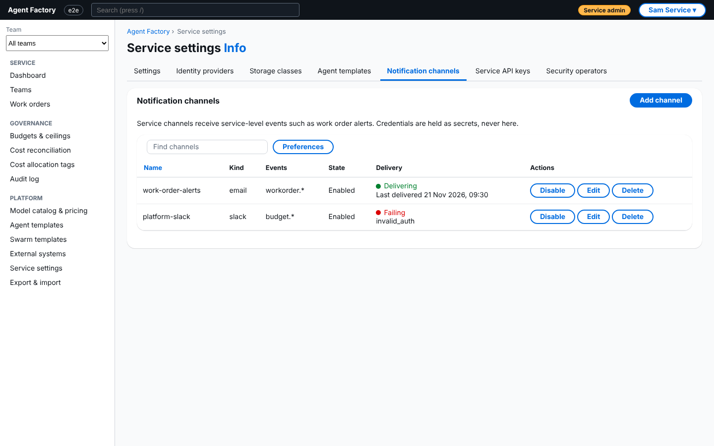

The service's own email, Slack, webhook and Jira channels, with their events and delivery status. Add, edit, enable,
disable and delete them. A channel's credential is a reference to a secret, never a value. Deleting the channel that
work orders name is refused by the API; disable it instead.

## Ephemeral teams

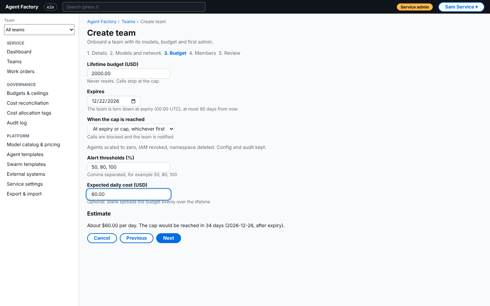

Choose *Ephemeral* as the kind when creating a team. The budget step then takes a lifetime budget (it never resets and
calls stop at the cap), an expiry date (at most the service's `teams.ephemeral_max_days` ahead) and a teardown rule:
*at expiry or cap, whichever first* (the default) or *at expiry only*. An estimate shows the daily cost (type your own, or
the budget is spread evenly) and the day the cap would be reached. An ephemeral team's overview has an *Ephemeral team*
card with the time to expiry and the spend against the cap, and after teardown when and why it happened.

## Pools and stages (ephemeral teams)

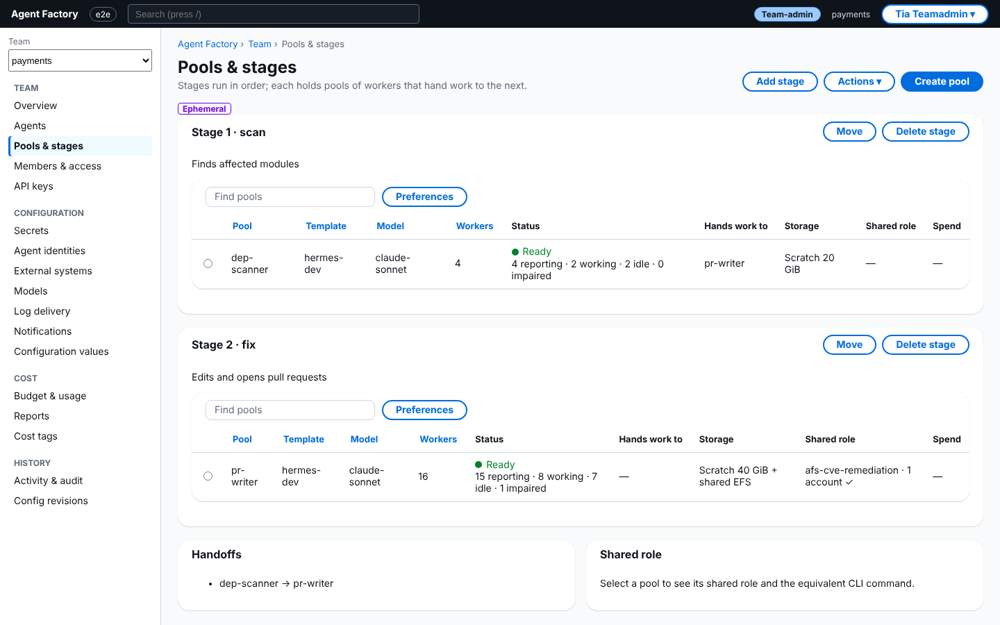

Ephemeral teams have a *Pools & stages* page (persistent teams do not). Stages run in position order (1 to 50); each stage
card lists its pools with template, model, desired workers, workers by what they report (reporting, working, idle,
impaired), the pools each hands work to, storage (scratch space and an optional shared EFS volume), the shared named
role with its linked accounts, and month-to-date spend. *Template retired* marks a pool whose template was disabled
after it was created. Select a pool, then use *Actions*: *Scale* (0 to 200 workers, with the CLI command), *Edit handoffs*,
*Link shared role* (one role name linked in each account the team's filter allows), *Pause*, *Resume* and *Delete*.
*Create pool* takes the agent sections (template, image, model, configuration, secrets) plus workers, stage, handoffs
and scratch space (1 to 500 GiB); the name must be unused by any agent or pool of the team and cannot change later.
Viewers see the page with every control disabled ("Requires team-admin").

## Guardrails and kubeconfig

Service admins can change a team's isolation tier, turn viewer kubectl on or off and set the orchestration endpoint limit (Off, Private or Public) from the team's *Guardrails* tab; other roles see the controls disabled with a tooltip naming the role. Each change shows the equivalent `afs` command before you confirm. When viewer kubectl is on, team members with access see a *Kubernetes access* card on the team overview with a *Download kubeconfig* button.

## Tag status (cost allocation tags)

Service admins see a *Tag status* card on the cost allocation tags page: for each tag key, whether it has appeared in the Cost and Usage Report, when it was first and last seen, and whether AWS Billing has it active. An active key not seen for 3 days or more is flagged with a warning; check that the key is activated in AWS Billing.

## Security operators

A security operator signs in to a reduced console: the header shows *Security operator*, the navigation has only *Work orders* and *Swarm templates*, and you land on *Work orders*. Team pages and service-admin pages are not found for this role.

## Work orders

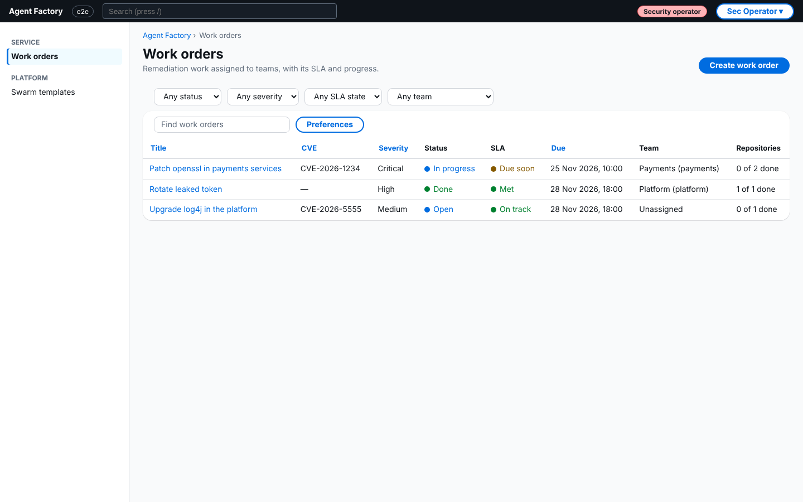

*Work orders* (service admins and security operators) lists work orders, most severe first, with filters for status, severity, SLA state and team. *Create work order* takes a CVE, severity, SLA due date, an enabled swarm template, an optional spend cap and the repositories, written `host/owner/repo`. Each repository can name an owning team, a contact email, both, or neither (the owner then comes from the teams' repository configuration). If the service finds a repository with several possible owners or none, the form pre-fills the candidates and marks the repository that needs one. A second work order for a CVE that is already open is refused, and the form links the open one.

A work order's page shows its SLA, the remediation team and spend against the cap, and one row per repository with its status, pull request and notifications sent. Cancelling asks for a reason. Team admins and viewers of an owning team can open it read-only and see only their own repositories. The form shows the equivalent `afs work-orders create-work-order` command.

## Swarm templates

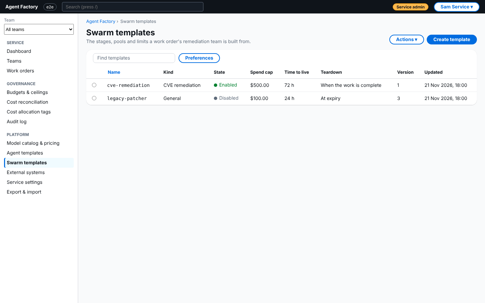

*Swarm templates* lists the templates a work order's remediation team is built from, with state, spend cap, time to live, teardown rule and version; select one to see its stages, pools, handoffs, secrets needed and configuration. Service admins create, edit, enable, disable and delete templates (a new template starts disabled; a template used by an open work order cannot be deleted). The spec is edited as JSON with the sections `stages`, `pools`, `handoffs`, `secrets` and `configValues`. Each secret is `{"pool": ..., "name": ...}` with an optional `description`, `delivery` (`env` or `file`) and `target` (an environment variable name or an absolute path); the pool must be one the template defines, and the console checks this before it saves. Security operators see the page read-only; a disabled template is not offered when creating a work order.

## Service API keys and security operators (`/settings/service-api-keys`, `/settings/security-operators`, service admins)

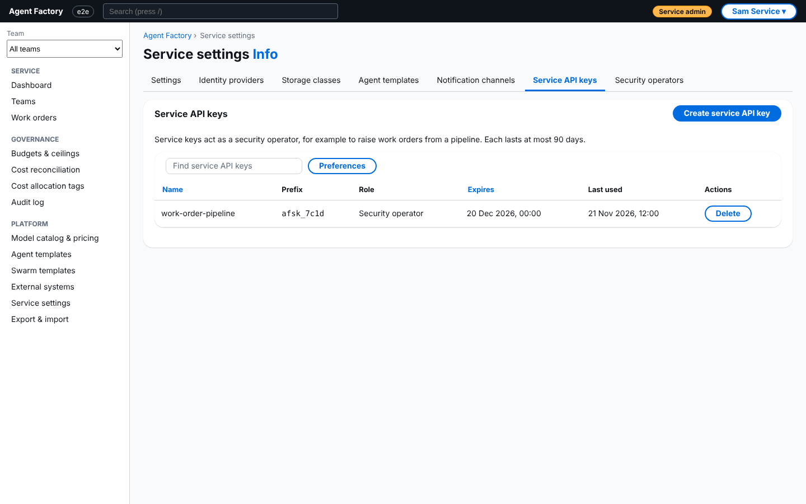

*Service API keys* are keys for automation, such as a pipeline that raises work orders. They always act as a security operator, last at most 90 days (30 by default) and are listed with their prefix, expiry and last use. The secret is shown once, when the key is created, and cannot be shown again; if a create is retried the console says so, and you delete the key and create a new one. *Security operators* lists the people and IdP groups bound to the security operator role; service admins add or remove them. Both pages show the equivalent `afs admin` command.

## Troubleshooting

- *Page not found* for a page you expect: you may not hold the role it needs, or the team is not yours.
- A banner at the top says the service is unavailable or throttling: the console retries; nothing is lost.
- "Change not applied yet" next to a team or agent: the reconciler has not caught up with your change.
